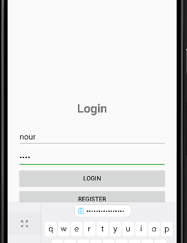
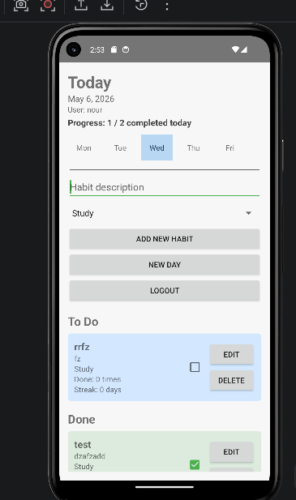

# Simple Habit Tracker

> University project - ISAMM, Computer Science. Built individually.

A native Android habit tracker written in Java. The app stores user accounts and habits locally with SQLite and supports multiple accounts on the device.

## Key Features

- Register and log in to a local account.
- Keep a session after login using `SharedPreferences`.
- Create habits with a title, description, and category.
- Edit or delete habits.
- Split habits into **To Do** and **Done** lists.
- Track completion counts and an in-app streak counter.
- Reset all of the current user's completed states with **New Day**.
- View today's date and select a day in the in-app weekly UI.

## Technologies

- Java 11
- Android SDK 35
- AndroidX AppCompat
- AndroidX RecyclerView
- XML layouts
- SQLite with `SQLiteOpenHelper`
- `SharedPreferences`
- Gradle 8.7.3

## Screenshots




## Project Structure

```text
app/src/main/
├── java/com/example/simplehabittracker/
│   ├── DatabaseHelper.java   # SQLite schema and data operations
│   ├── Habit.java            # Habit model
│   ├── HabitAdapter.java     # RecyclerView bindings and actions
│   ├── LoginActivity.java    # Login and session handling
│   ├── MainActivity.java     # Habit screen and interactions
│   └── RegisterActivity.java # Account registration
├── res/layout/
│   ├── activity_login.xml
│   ├── activity_register.xml
│   ├── activity_main.xml
│   └── item_habit.xml
└── AndroidManifest.xml
```

The application package is `com.example.simplehabittracker`. The minimum SDK is 23, and the target SDK is 35.

## Setup

### Requirements

- Android Studio
- Android SDK 35
- An Android emulator or a device running Android 6.0 (API 23) or newer

### Run the app

1. Clone the repository:

   ```bash
   git clone https://github.com/Nour-Abbes/Habit-Tracker-App-Uni-project.git
   cd Habit-Tracker-App-Uni-project
   ```

2. Open the project folder in Android Studio.
3. Let Gradle sync the project.
4. Select the `app` configuration and run it on an emulator or connected device.

To build a debug APK from the command line:

```bash
./gradlew assembleDebug
```

The resulting APK is written to `app/build/outputs/apk/debug/`.

## Local Data

The app uses a SQLite database named `habits.db`. The `users` table stores user ID, username, and password; the `habits` table stores habit fields, ownership, completion state, completion count, and streak value.

`LoginActivity` uses a session in `user_session` to store the current user ID and username in `SharedPreferences`. It does not store the password in that session.

## Known Limitations

- Passwords are currently stored in plaintext in SQLite. A future improvement is secure password hashing.
- Streaks are based on completion counters rather than consecutive calendar days.
- The weekly date selector is visual only and does not load historical habits.
